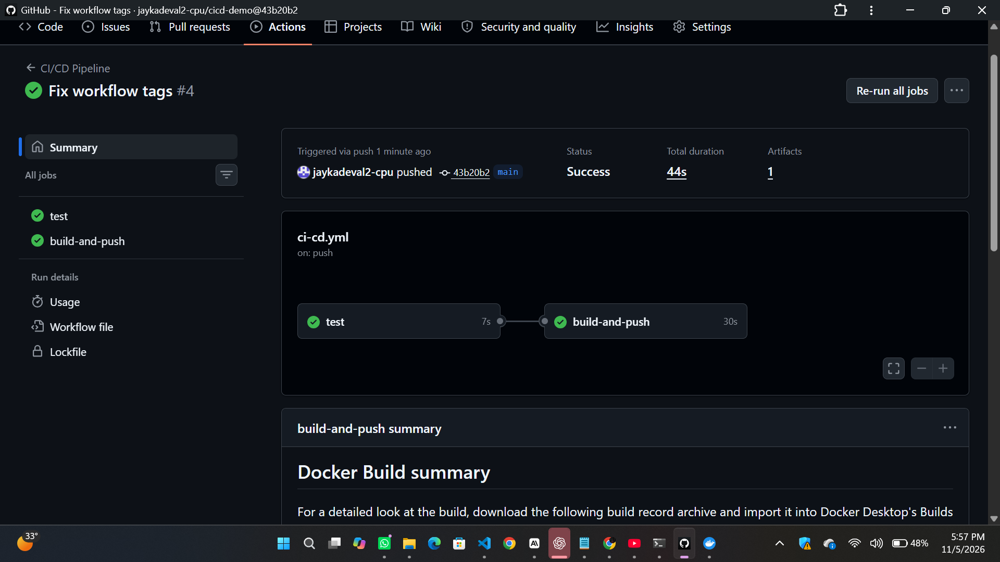
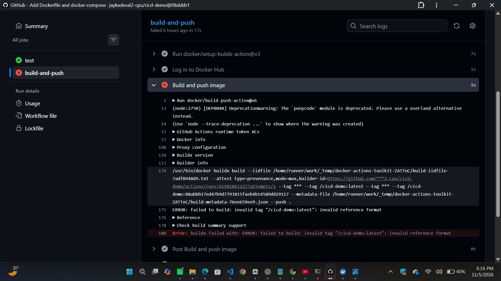
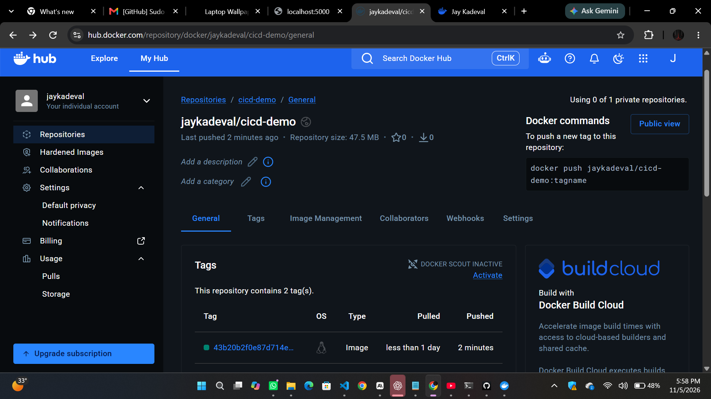
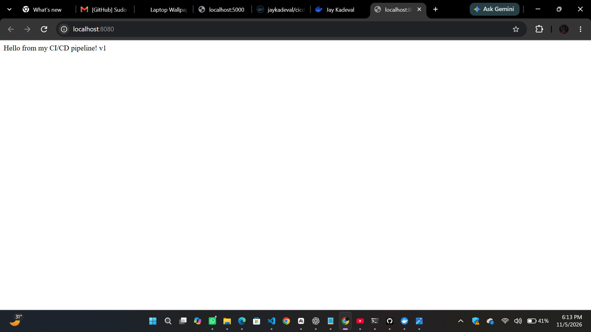
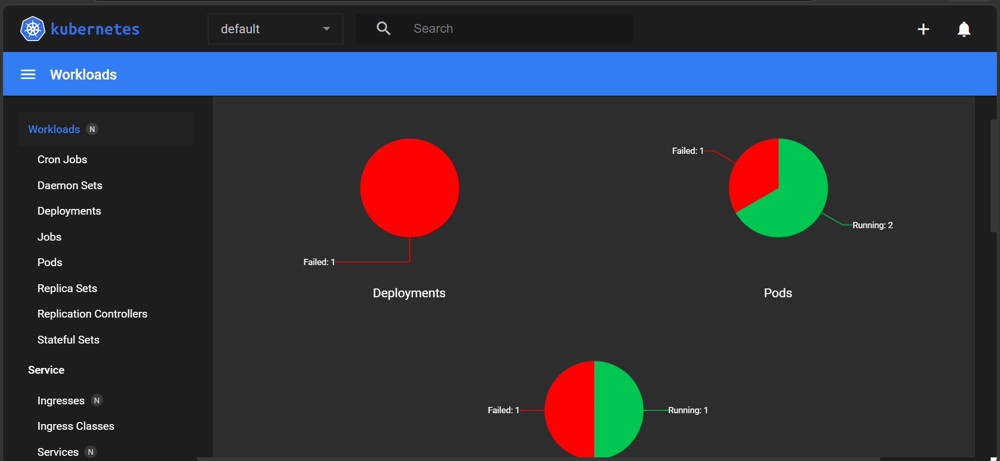

# CI/CD Pipeline with GitHub Actions, Docker & Minikube

A Flask app with a full CI/CD pipeline: every push to `main` runs tests,
builds a Docker image, pushes it to Docker Hub, and the image is deployed
to a local Minikube Kubernetes cluster.

## Pipeline

Push to GitHub → pytest → Docker build → Push to Docker Hub → Minikube pulls & runs

## Links
- Docker image: https://hub.docker.com/r/<your-username>/cicd-demo
- Workflow runs: https://github.com/<your-username>/cicd-demo/actions

## Tech stack
Python/Flask, pytest, Docker, docker-compose, GitHub Actions, Docker Hub, Kubernetes (Minikube)

## Run locally
```bash
docker compose up --build        # http://localhost:5000
```

## Deploy to Minikube
```bash
minikube start --driver=docker
kubectl apply -f k8s/
minikube service cicd-demo --url
```

## Screenshots




